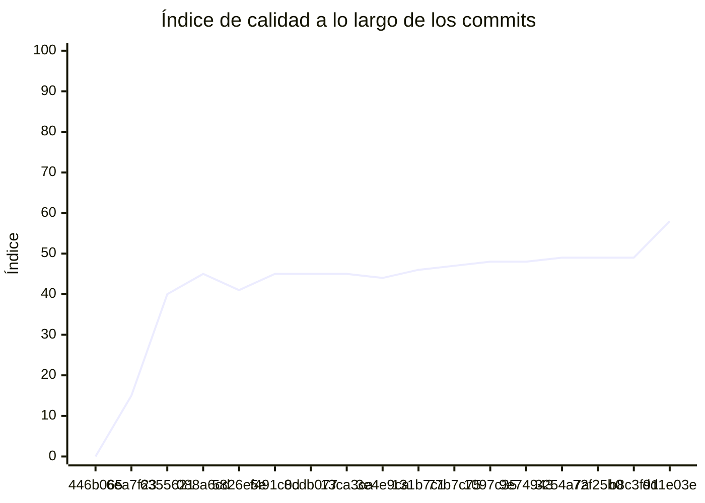

<!-- evaluacion:inicio -->
# Evaluación — mmachinea-pr2/turnos-booking-services

> Documento **generado automáticamente** por la cátedra de Programación II (UM): RepoSense + análisis de calidad de **7 dimensiones**. **No editar a mano**: se regenera en cada evaluación.
> Rama evaluada: `main`. Análisis **heurístico** (regex + métricas) + build: es una criba para orientar la revisión, **no una nota**. La **documentación** del repositorio no se evalúa.
> Generado: 2026-11-20.

## 1. Veredicto

| Aspecto | Resultado |
|---|---|
| Índice de calidad | **73/100** |
| Tipo de repositorio | `backend` |
| Build (`mvnw verify` / `gradlew check`) | OK |
| Código (LOC) | 4,506 |
| Archivos de código | 87 |
| Clases | 115 |
| Código dentro de clases (%POO) | 82% |
| Funciones fuera de clases | 0 |
| Duplicación (puerta) | 0.0% |
| Duplicación lógica | 0.0% |
| Duplicación de boilerplate | 6.0% |
| Cobertura | 98% |

> Este informe **describe** lo que el análisis midió con los criterios ya establecidos de la materia. No es una nota.

## 2. Semáforo de aprobación

Criterios de la cátedra (`CRITERIOS-CALIDAD.md`): **Aprobar** se juega con el perfil `estandar`; **destacar**, con el `exigente` (meta de excelencia).

| Semáforo | Resultado |
|---|---|
| Aprobar (`estandar`) | **cumple** — 8/11 |
| Destacar (`exigente`) | **no cumple** — 7/11 |

**Para destacar, falta cumplir:** SOLID

## 3. Autoría (RepoSense)

| Autor | Commits | Código (LOC) | Tests (LOC) | Docs (LOC) | Días activos | % del código |
|---|---:|---:|---:|---:|---:|---:|
| pilarmachinea | 29 | 2,404 | 2,680 | 1,757 | 8 | 100% |

> _El LOC de autoría lo calcula RepoSense sobre el historial y puede diferir del LOC de código del análisis (que mira el estado de `main`)._

## 4. Dimensiones evaluadas

Cada dimensión indica **qué mide**, **por qué importa** y **tu resultado**. Cuando el puntaje queda por debajo de la referencia, se agregan preguntas para **investigar la causa** (no hay recetas).

| Dimensión | Peso | Puntaje |
|:--|--:|--:|
| **D1** Diseño OO, SOLID y patrones (20%) | 20% | 3 |
| **D2** Arquitectura hexagonal — backend (15%) | 15% | 86 |
| **D3** Frontend KMP: MVVM y buenas prácticas (10%) | 10% | N/A |
| **D4** Integración y contrato (10%) | 10% | 70 |
| **D5** Seguridad y robustez (10%) | 10% | 100 |
| **D6** Pruebas y cobertura (20%) | 20% | 100 |
| **D7** Proceso y entrega (15%) | 15% | 100 |

### D1. Diseño OO, SOLID y patrones (20%)

- **Qué mide:** Métricas orientadas a objetos (clases, métodos, campos, cohesión, acoplamiento, herencia) y proxies de SOLID, más patrones de diseño.
- **Por qué importa:** El eje de la materia es el buen uso de la POO y su arquitectura: un diseño con clases claras y poco acopladas es más fácil de entender, probar y cambiar.
- **Tu resultado:** **3/100**
- **Para investigar la causa:**
    - ¿Se pensó el modelo de clases antes de codificar o se agrupó después?
    - ¿Qué clases concentran muchas responsabilidades a la vez?
    - ¿Los colaboradores llegan como parámetros o se crean por dentro?

### D2. Arquitectura hexagonal — backend (15%)

- **Qué mide:** Separación en capas (dominio, puertos de entrada/salida, adaptadores) y dirección de las dependencias del backend.
- **Por qué importa:** Aislar el dominio de la infraestructura permite cambiar la base de datos, el framework o el transporte sin tocar las reglas de negocio.
- **Tu resultado:** **86/100**

### D4. Integración y contrato (10%)

- **Qué mide:** Cumplimiento del contrato de integración de la cátedra (formato de errores, paginación, autenticación, endpoints esperados).
- **Por qué importa:** Los servicios deben poder integrarse entre sí y con la app sin sorpresas; el contrato es lo que hacen cumplir las pruebas de integración.
- **Tu resultado:** **70/100**

### D5. Seguridad y robustez (10%)

- **Qué mide:** Credenciales embebidas, consultas SQL por concatenación, y presencia de config de entorno; aislamiento de secretos.
- **Por qué importa:** Un secreto en el repositorio o una consulta construida por concatenación son riesgos concretos, no hipotéticos.
- **Tu resultado:** **100/100**

### D6. Pruebas y cobertura (20%)

- **Qué mide:** Cantidad y resultado de pruebas y cobertura de línea (JaCoCo/Kover, Surefire/Failsafe) cuando hay build.
- **Por qué importa:** Las pruebas son la red de seguridad para refactorizar e integrar; la cobertura acota las zonas sin verificar.
- **Tu resultado:** **100/100**

### D7. Proceso y entrega (15%)

- **Qué mide:** Artefactos verificables de proceso/entrega: `compose`, `.env.example`, CI (`.github/workflows/`), `CODEOWNERS` y wrapper de build (`mvnw`/`gradlew`). **No** puntúa documentación.
- **Por qué importa:** Un proyecto que compila, se levanta y se valida solo es más fácil de revisar y de integrar en equipo.
- **Tu resultado:** **100/100**

## 5. Señales detectadas

El análisis encontró las siguientes señales, con el archivo y la línea donde se originan cuando están disponibles:

**Archivos con más señales**

| Archivo | Señales |
|---|---:|
| `src/main/java/ar/edu/programacion2/booking/phone/PhoneSubmissionOutbox.java` | 9 |
| `src/main/java/ar/edu/programacion2/booking/holds/HoldRepository.java` | 7 |
| `src/main/java/ar/edu/programacion2/booking/holds/HoldGateway.java` | 6 |
| `src/main/java/ar/edu/programacion2/booking/phone/BookingOutcomeHandler.java` | 6 |
| `src/main/java/ar/edu/programacion2/booking/phone/BookingEvent.java` | 5 |
| `src/main/java/ar/edu/programacion2/booking/appointments/RestAppointmentGateway.java` | 4 |
| `src/main/java/ar/edu/programacion2/booking/cancellation/CancellationRepository.java` | 4 |
| `src/main/java/ar/edu/programacion2/booking/availability/AvailabilityService.java` | 4 |
| `src/main/java/ar/edu/programacion2/booking/holds/HoldService.java` | 4 |
| `src/main/java/ar/edu/programacion2/booking/holds/RestHoldGateway.java` | 4 |

**SRP/responsabilidad** (53)
- método 'Appointment.Appointment' con 10 parámetros — `src/main/java/ar/edu/programacion2/booking/appointments/Appointment.java:7`
- método 'AppointmentService.reconcile' con complejidad 6 — `src/main/java/ar/edu/programacion2/booking/appointments/AppointmentService.java:25`
- clase 'RestAppointmentGateway' con baja cohesión (5%) — `src/main/java/ar/edu/programacion2/booking/appointments/RestAppointmentGateway.java:14`
- método 'RestAppointmentGateway.find' con complejidad 9 — `src/main/java/ar/edu/programacion2/booking/appointments/RestAppointmentGateway.java:23`
- método 'ReconciliationPolicy.decide' con complejidad 8 — `src/main/java/ar/edu/programacion2/booking/appointments/domain/ReconciliationPolicy.java:10`
- método 'ReconciliationState.ReconciliationState' con 7 parámetros — `src/main/java/ar/edu/programacion2/booking/appointments/domain/ReconciliationState.java:7`
- método 'JdbcReconciliationStore.apply' con 5 parámetros — `src/main/java/ar/edu/programacion2/booking/appointments/infrastructure/persistence/JdbcReconciliationStore.java:31`
- método 'JdbcReconciliationStore.apply' con complejidad 14 — `src/main/java/ar/edu/programacion2/booking/appointments/infrastructure/persistence/JdbcReconciliationStore.java:31`
- clase 'AvailabilityService' grande (LOC=58, métodos=10, campos=2) — `src/main/java/ar/edu/programacion2/booking/availability/AvailabilityService.java:8`
- método 'AvailabilityService.find' con complejidad 6 — `src/main/java/ar/edu/programacion2/booking/availability/AvailabilityService.java:16`
- método 'AvailabilitySource.Schedule' con 5 parámetros — `src/main/java/ar/edu/programacion2/booking/availability/AvailabilitySource.java:10`
- método 'Schedule.Schedule' con 5 parámetros — `src/main/java/ar/edu/programacion2/booking/availability/AvailabilitySource.java:10`
- clase 'RestAvailabilitySource' con baja cohesión (11%) — `src/main/java/ar/edu/programacion2/booking/availability/RestAvailabilitySource.java:9`
- método 'Cancellation.Cancellation' con 9 parámetros — `src/main/java/ar/edu/programacion2/booking/cancellation/Cancellation.java:5`
- método 'CancellationRepository.claim' con complejidad 9 — `src/main/java/ar/edu/programacion2/booking/cancellation/CancellationRepository.java:29`
- método 'CancellationRepository.finish' con complejidad 8 — `src/main/java/ar/edu/programacion2/booking/cancellation/CancellationRepository.java:47`
- clase 'RestCancellationGateway' con baja cohesión (5%) — `src/main/java/ar/edu/programacion2/booking/cancellation/RestCancellationGateway.java:14`
- método 'HoldController.create' con complejidad 6 — `src/main/java/ar/edu/programacion2/booking/holds/HoldController.java:39`
- método 'HoldGateway.Outcome' con 5 parámetros — `src/main/java/ar/edu/programacion2/booking/holds/HoldGateway.java:8`
- método 'Outcome.Outcome' con 5 parámetros — `src/main/java/ar/edu/programacion2/booking/holds/HoldGateway.java:8`
- clase 'HoldRepository' grande (LOC=85, métodos=10, campos=2) — `src/main/java/ar/edu/programacion2/booking/holds/HoldRepository.java:14`
- método 'HoldRepository.start' con complejidad 18 — `src/main/java/ar/edu/programacion2/booking/holds/HoldRepository.java:37`
- método 'HoldRepository.finish' con complejidad 10 — `src/main/java/ar/edu/programacion2/booking/holds/HoldRepository.java:61`
- método 'HoldRepository.claimConfirmation' con complejidad 9 — `src/main/java/ar/edu/programacion2/booking/holds/HoldRepository.java:71`
- método 'HoldRepository.finishConfirmation' con complejidad 7 — `src/main/java/ar/edu/programacion2/booking/holds/HoldRepository.java:88`
- método 'HoldService.HoldService' con 5 parámetros — `src/main/java/ar/edu/programacion2/booking/holds/HoldService.java:15`
- método 'HoldService.create' con complejidad 6 — `src/main/java/ar/edu/programacion2/booking/holds/HoldService.java:23`
- método 'ReservationProcess.ReservationProcess' con 10 parámetros — `src/main/java/ar/edu/programacion2/booking/holds/ReservationProcess.java:5`
- clase 'RestHoldGateway' grande (LOC=95, métodos=16, campos=5) — `src/main/java/ar/edu/programacion2/booking/holds/RestHoldGateway.java:15`
- clase 'RestHoldGateway' con baja cohesión (2%) — `src/main/java/ar/edu/programacion2/booking/holds/RestHoldGateway.java:15`
- método 'BookingEvent.BookingEvent' de 67 líneas — `src/main/java/ar/edu/programacion2/booking/phone/BookingEvent.java:7`
- método 'BookingEvent.BookingEvent' con complejidad 17 — `src/main/java/ar/edu/programacion2/booking/phone/BookingEvent.java:7`
- método 'BookingEvent.parse' con complejidad 7 — `src/main/java/ar/edu/programacion2/booking/phone/BookingEvent.java:11`
- método 'BookingEvent.validateResult' con complejidad 9 — `src/main/java/ar/edu/programacion2/booking/phone/BookingEvent.java:34`
- método 'BookingEventInbox.receive' con complejidad 9 — `src/main/java/ar/edu/programacion2/booking/phone/BookingEventInbox.java:22`
- método 'BookingEventInbox.apply' de 41 líneas — `src/main/java/ar/edu/programacion2/booking/phone/BookingEventInbox.java:59`
- método 'BookingEventInbox.apply' con complejidad 14 — `src/main/java/ar/edu/programacion2/booking/phone/BookingEventInbox.java:59`
- clase 'BookingOutcomeHandler' grande (LOC=107, métodos=9, campos=9) — `src/main/java/ar/edu/programacion2/booking/phone/BookingOutcomeHandler.java:14`
- clase 'BookingOutcomeHandler' con baja cohesión (28%) — `src/main/java/ar/edu/programacion2/booking/phone/BookingOutcomeHandler.java:14`
- método 'BookingOutcomeHandler.apply' de 41 líneas — `src/main/java/ar/edu/programacion2/booking/phone/BookingOutcomeHandler.java:35`
- método 'BookingOutcomeHandler.apply' con complejidad 34 — `src/main/java/ar/edu/programacion2/booking/phone/BookingOutcomeHandler.java:35`
- método 'BookingResult.BookingResult' con 9 parámetros — `src/main/java/ar/edu/programacion2/booking/phone/BookingResult.java:5`
- método 'PhoneSubmission.PhoneSubmission' con 5 parámetros — `src/main/java/ar/edu/programacion2/booking/phone/PhoneSubmission.java:5`
- clase 'PhoneSubmissionOutbox' grande (LOC=114, métodos=14, campos=6) — `src/main/java/ar/edu/programacion2/booking/phone/PhoneSubmissionOutbox.java:20`
- clase 'PhoneSubmissionOutbox' con baja cohesión (49%) — `src/main/java/ar/edu/programacion2/booking/phone/PhoneSubmissionOutbox.java:20`
- método 'PhoneSubmissionOutbox.submit' de 31 líneas — `src/main/java/ar/edu/programacion2/booking/phone/PhoneSubmissionOutbox.java:38`
- método 'PhoneSubmissionOutbox.submit' con complejidad 16 — `src/main/java/ar/edu/programacion2/booking/phone/PhoneSubmissionOutbox.java:38`
- método 'PhoneSubmissionOutbox.claim' con complejidad 8 — `src/main/java/ar/edu/programacion2/booking/phone/PhoneSubmissionOutbox.java:92`
- método 'PhoneSubmissionOutbox.Delivery' con 5 parámetros — `src/main/java/ar/edu/programacion2/booking/phone/PhoneSubmissionOutbox.java:130`
- método 'Delivery.Delivery' con 5 parámetros — `src/main/java/ar/edu/programacion2/booking/phone/PhoneSubmissionOutbox.java:130`
- clase 'JwtSettings' con baja cohesión (40%) — `src/main/java/ar/edu/programacion2/booking/security/JwtSettings.java:12`
- método 'UserAccount.UserAccount' con 9 parámetros — `src/main/java/ar/edu/programacion2/booking/users/UserAccount.java:5`
- método 'UserRepository.insert' con complejidad 9 — `src/main/java/ar/edu/programacion2/booking/users/UserRepository.java:24`

**DIP/concretos** (58)
- clase 'AppointmentController' muy acoplada (CBO=10) — `src/main/java/ar/edu/programacion2/booking/appointments/AppointmentController.java:10`
- clase 'AppointmentService' muy acoplada (CBO=14) — `src/main/java/ar/edu/programacion2/booking/appointments/AppointmentService.java:8`
- clase 'RestAppointmentGateway' muy acoplada (CBO=21) — `src/main/java/ar/edu/programacion2/booking/appointments/RestAppointmentGateway.java:14`
- clase 'RestAppointmentGateway' instancia 6 concretos (CBO=21) — `src/main/java/ar/edu/programacion2/booking/appointments/RestAppointmentGateway.java:14`
- clase 'ReconciliationPolicy' muy acoplada (CBO=16) — `src/main/java/ar/edu/programacion2/booking/appointments/domain/ReconciliationPolicy.java:9`
- clase 'ReconciliationPolicy' instancia 3 concretos (CBO=16) — `src/main/java/ar/edu/programacion2/booking/appointments/domain/ReconciliationPolicy.java:9`
- clase 'JdbcReconciliationStore' muy acoplada (CBO=23) — `src/main/java/ar/edu/programacion2/booking/appointments/infrastructure/persistence/JdbcReconciliationStore.java:16`
- clase 'AvailabilityConfiguration' muy acoplada (CBO=10) — `src/main/java/ar/edu/programacion2/booking/availability/AvailabilityConfiguration.java:10`
- clase 'AvailabilityController' muy acoplada (CBO=9) — `src/main/java/ar/edu/programacion2/booking/availability/AvailabilityController.java:12`
- clase 'AvailabilityService' muy acoplada (CBO=16) — `src/main/java/ar/edu/programacion2/booking/availability/AvailabilityService.java:8`
- clase 'AvailabilityService' instancia 6 concretos (CBO=16) — `src/main/java/ar/edu/programacion2/booking/availability/AvailabilityService.java:8`
- clase 'RestAvailabilitySource' muy acoplada (CBO=10) — `src/main/java/ar/edu/programacion2/booking/availability/RestAvailabilitySource.java:9`
- clase 'RestAvailabilitySource' instancia 6 concretos (CBO=10) — `src/main/java/ar/edu/programacion2/booking/availability/RestAvailabilitySource.java:9`
- clase 'CancellationController' muy acoplada (CBO=10) — `src/main/java/ar/edu/programacion2/booking/cancellation/CancellationController.java:13`
- clase 'CancellationRepository' muy acoplada (CBO=29) — `src/main/java/ar/edu/programacion2/booking/cancellation/CancellationRepository.java:14`
- clase 'CancellationRepository' instancia 6 concretos (CBO=29) — `src/main/java/ar/edu/programacion2/booking/cancellation/CancellationRepository.java:14`
- clase 'RestCancellationGateway' muy acoplada (CBO=21) — `src/main/java/ar/edu/programacion2/booking/cancellation/RestCancellationGateway.java:14`
- clase 'RestCancellationGateway' instancia 4 concretos (CBO=21) — `src/main/java/ar/edu/programacion2/booking/cancellation/RestCancellationGateway.java:14`
- clase 'ConfirmHoldController' muy acoplada (CBO=13) — `src/main/java/ar/edu/programacion2/booking/holds/ConfirmHoldController.java:13`
- clase 'ConfirmHoldService' muy acoplada (CBO=19) — `src/main/java/ar/edu/programacion2/booking/holds/ConfirmHoldService.java:8`
- clase 'HoldController' muy acoplada (CBO=23) — `src/main/java/ar/edu/programacion2/booking/holds/HoldController.java:12`
- clase 'HoldErrors' muy acoplada (CBO=15) — `src/main/java/ar/edu/programacion2/booking/holds/HoldErrors.java:13`
- clase 'HoldGateway' muy acoplada (CBO=10) — `src/main/java/ar/edu/programacion2/booking/holds/HoldGateway.java:5`
- clase 'HoldGateway' instancia 3 concretos (CBO=10) — `src/main/java/ar/edu/programacion2/booking/holds/HoldGateway.java:5`
- clase 'Outcome' muy acoplada (CBO=8) — `src/main/java/ar/edu/programacion2/booking/holds/HoldGateway.java:8`
- clase 'Outcome' instancia 3 concretos (CBO=8) — `src/main/java/ar/edu/programacion2/booking/holds/HoldGateway.java:8`
- clase 'HoldRepository' muy acoplada (CBO=44) — `src/main/java/ar/edu/programacion2/booking/holds/HoldRepository.java:14`
- clase 'HoldRepository' instancia 9 concretos (CBO=44) — `src/main/java/ar/edu/programacion2/booking/holds/HoldRepository.java:14`
- clase 'HoldService' muy acoplada (CBO=13) — `src/main/java/ar/edu/programacion2/booking/holds/HoldService.java:9`
- clase 'HoldService' instancia 6 concretos (CBO=13) — `src/main/java/ar/edu/programacion2/booking/holds/HoldService.java:9`
- clase 'ReservationProcess' muy acoplada (CBO=15) — `src/main/java/ar/edu/programacion2/booking/holds/ReservationProcess.java:5`
- clase 'Status' muy acoplada (CBO=11) — `src/main/java/ar/edu/programacion2/booking/holds/ReservationProcess.java:8`
- clase 'RestHoldGateway' muy acoplada (CBO=32) — `src/main/java/ar/edu/programacion2/booking/holds/RestHoldGateway.java:15`
- clase 'RestHoldGateway' instancia 5 concretos (CBO=32) — `src/main/java/ar/edu/programacion2/booking/holds/RestHoldGateway.java:15`
- clase 'IntegrationHttpClient' muy acoplada (CBO=10) — `src/main/java/ar/edu/programacion2/booking/integration/IntegrationHttpClient.java:8`
- clase 'BookingEvent' muy acoplada (CBO=20) — `src/main/java/ar/edu/programacion2/booking/phone/BookingEvent.java:7`
- clase 'BookingEventInbox' muy acoplada (CBO=53) — `src/main/java/ar/edu/programacion2/booking/phone/BookingEventInbox.java:12`
- clase 'BookingKafkaConfiguration' muy acoplada (CBO=23) — `src/main/java/ar/edu/programacion2/booking/phone/BookingKafkaConfiguration.java:20`
- clase 'BookingKafkaConfiguration' instancia 4 concretos (CBO=23) — `src/main/java/ar/edu/programacion2/booking/phone/BookingKafkaConfiguration.java:20`
- clase 'BookingOutcomeHandler' muy acoplada (CBO=36) — `src/main/java/ar/edu/programacion2/booking/phone/BookingOutcomeHandler.java:14`
- clase 'BookingOutcomeHandler' instancia 4 concretos (CBO=36) — `src/main/java/ar/edu/programacion2/booking/phone/BookingOutcomeHandler.java:14`
- clase 'KafkaPhonePublisher' muy acoplada (CBO=10) — `src/main/java/ar/edu/programacion2/booking/phone/KafkaPhonePublisher.java:6`
- clase 'PhoneOutboxRelay' muy acoplada (CBO=8) — `src/main/java/ar/edu/programacion2/booking/phone/PhoneOutboxRelay.java:9`
- clase 'PhoneProducerConfiguration' muy acoplada (CBO=22) — `src/main/java/ar/edu/programacion2/booking/phone/PhoneProducerConfiguration.java:15`
- clase 'PhoneSubmissionController' muy acoplada (CBO=8) — `src/main/java/ar/edu/programacion2/booking/phone/PhoneSubmissionController.java:13`
- clase 'PhoneSubmissionOutbox' muy acoplada (CBO=49) — `src/main/java/ar/edu/programacion2/booking/phone/PhoneSubmissionOutbox.java:20`
- clase 'PhoneSubmissionOutbox' instancia 9 concretos (CBO=49) — `src/main/java/ar/edu/programacion2/booking/phone/PhoneSubmissionOutbox.java:20`
- clase 'CorsConfiguration' muy acoplada (CBO=14) — `src/main/java/ar/edu/programacion2/booking/security/CorsConfiguration.java:13`
- clase 'JwtSettings' muy acoplada (CBO=10) — `src/main/java/ar/edu/programacion2/booking/security/JwtSettings.java:12`
- clase 'JwtSettings' instancia 4 concretos (CBO=10) — `src/main/java/ar/edu/programacion2/booking/security/JwtSettings.java:12`
- clase 'SecurityConfiguration' muy acoplada (CBO=33) — `src/main/java/ar/edu/programacion2/booking/security/SecurityConfiguration.java:20`
- clase 'SecurityConfiguration' instancia 6 concretos (CBO=33) — `src/main/java/ar/edu/programacion2/booking/security/SecurityConfiguration.java:20`
- clase 'TokenService' muy acoplada (CBO=10) — `src/main/java/ar/edu/programacion2/booking/security/TokenService.java:11`
- clase 'AccountController' muy acoplada (CBO=14) — `src/main/java/ar/edu/programacion2/booking/users/AccountController.java:12`
- clase 'AccountErrors' muy acoplada (CBO=13) — `src/main/java/ar/edu/programacion2/booking/users/AccountErrors.java:10`
- clase 'UserRepository' muy acoplada (CBO=11) — `src/main/java/ar/edu/programacion2/booking/users/UserRepository.java:10`
- clase 'UserService' muy acoplada (CBO=15) — `src/main/java/ar/edu/programacion2/booking/users/UserService.java:13`
- clase 'UserService' instancia 4 concretos (CBO=15) — `src/main/java/ar/edu/programacion2/booking/users/UserService.java:13`

**OCP/type-switch** (1)
- clase 'SecurityConfiguration' con 1 type-checks — `src/main/java/ar/edu/programacion2/booking/security/SecurityConfiguration.java:20`

**hexagonal** (1)
- falta ports/in (hexagonal)

## 6. Evolución por commit

Métricas calculadas sobre el estado de `main` en **cada commit** (17 commits con trabajo), del primero al último. La calidad usa el perfil `exigente`; el aporte de código lo mide RepoSense. El índice puede **bajar** al crecer el proyecto: se acumulan señales.

| # | Fecha | Commit | Autor | LOC | Índice | %POO | Duplic. | Sueltas |
|---|---|---|---|---:|---:|---:|---:|---:|
| 1 | 2026-09-21 | `446b065` | pilarmachinea | 0 | 0 | 0% | 0.0% | 0 |
| 2 | 2026-09-22 | `6ea7f23` | Ing. Daniel Quinteros | 0 | 15 | 0% | 0.0% | 0 |
| 3 | 2026-11-03 | `6355621` | pilarmachinea | 69 | 40 | 56% | 0.0% | 0 |
| 4 | 2026-11-03 | `088a6cd` | pilarmachinea | 69 | 45 | 56% | 0.0% | 0 |
| 5 | 2026-11-03 | `5826e5e` | pilarmachinea | 623 | 41 | 73% | 0.0% | 0 |
| 6 | 2026-11-05 | `f491c0d` | pilarmachinea | 673 | 45 | 73% | 0.0% | 0 |
| 7 | 2026-11-05 | `8cdb077` | pilarmachinea | 1,103 | 45 | 77% | 0.0% | 0 |
| 8 | 2026-11-09 | `13ca3ca` | pilarmachinea | 1,676 | 45 | 79% | 0.0% | 0 |
| 9 | 2026-11-09 | `3e4e9ca` | pilarmachinea | 2,016 | 44 | 81% | 0.0% | 0 |
| 10 | 2026-11-09 | `131b7c1` | pilarmachinea | 2,543 | 46 | 81% | 0.0% | 0 |
| 11 | 2026-11-09 | `77b7c75` | pilarmachinea | 3,125 | 47 | 81% | 0.0% | 0 |
| 12 | 2026-11-10 | `1097c35` | pilarmachinea | 3,537 | 48 | 82% | 0.0% | 0 |
| 13 | 2026-11-10 | `9e74943` | pilarmachinea | 3,894 | 48 | 82% | 0.0% | 0 |
| 14 | 2026-11-10 | `3254a7a` | pilarmachinea | 4,342 | 49 | 82% | 0.0% | 0 |
| 15 | 2026-11-11 | `72f25b0` | pilarmachinea | 4,342 | 49 | 82% | 0.0% | 0 |
| 16 | 2026-11-17 | `b8c3f91` | pilarmachinea | 4,342 | 49 | 82% | 0.0% | 0 |
| 17 | 2026-11-19 | `dd1e03e` | Ing. Daniel Quinteros | 4,506 | 58 | 82% | 0.0% | 0 |

---
_Informe generado por la cátedra. Las dimensiones y umbrales corresponden a `calidad.py` (perfil `exigente`); el semáforo, a `CRITERIOS-CALIDAD.md`. La documentación del repositorio no se evalúa. Ante dudas, revisá el archivo señalado._
<!-- evaluacion:fin -->
