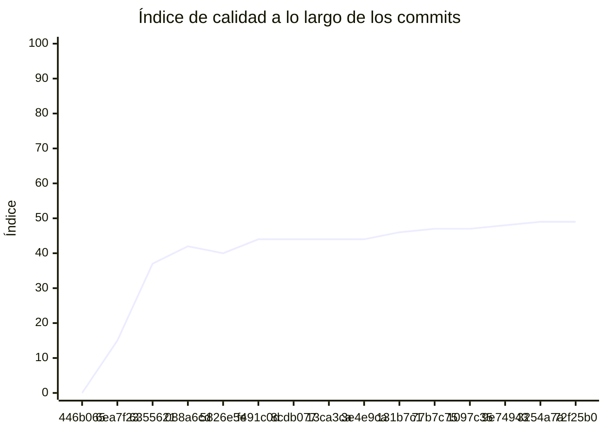

<!-- evaluacion:inicio -->
# Evaluación — mmachinea-pr2/turnos-booking-services

> Documento **generado automáticamente** por la cátedra de Programación II (UM): RepoSense + análisis de calidad de **7 dimensiones**. **No editar a mano**: se regenera en cada evaluación.
> Rama evaluada: `main`. Análisis **heurístico** (regex + métricas) + build: es una criba para orientar la revisión, **no una nota**. La **documentación** del repositorio no se evalúa.
> Generado: 2026-11-12.

## 1. Veredicto

| Aspecto | Resultado |
|---|---|
| Índice de calidad | **64/100** |
| Tipo de repositorio | `backend` |
| Build (`mvnw verify` / `gradlew check`) | OK |
| Código (LOC) | 4,342 |
| Archivos de código | 79 |
| Clases | 107 |
| Código dentro de clases (%POO) | 89% |
| Funciones fuera de clases | 1 |
| Duplicación (puerta) | 0.0% |
| Duplicación lógica | 0.0% |
| Duplicación de boilerplate | 6.4% |
| Cobertura | 98% |
| Tope duro aplicado a D1 | `SUELTAS` → D1 ≤ 60 |

> Este informe **describe** lo que el análisis midió con los criterios ya establecidos de la materia. No es una nota.

## 2. Semáforo de aprobación

Criterios de la cátedra (`CRITERIOS-CALIDAD.md`): **Aprobar** se juega con el perfil `estandar`; **destacar**, con el `exigente` (meta de excelencia).

| Semáforo | Resultado |
|---|---|
| Aprobar (`estandar`) | **no cumple** — 7/11 |
| Destacar (`exigente`) | **no cumple** — 7/11 |

**Para aprobar, falta cumplir:** SOLID

**Para destacar, falta cumplir:** SOLID

## 3. Autoría (RepoSense)

| Autor | Commits | Código (LOC) | Tests (LOC) | Docs (LOC) | Días activos | % del código |
|---|---:|---:|---:|---:|---:|---:|
| pilarmachinea | 24 | 2,303 | 2,615 | 1,364 | 7 | 100% |

> _El LOC de autoría lo calcula RepoSense sobre el historial y puede diferir del LOC de código del análisis (que mira el estado de `main`)._

## 4. Dimensiones evaluadas

Cada dimensión indica **qué mide**, **por qué importa** y **tu resultado**. Cuando el puntaje queda por debajo de la referencia, se agregan preguntas para **investigar la causa** (no hay recetas).

| Dimensión | Peso | Puntaje |
|:--|--:|--:|
| **D1** Diseño OO, SOLID y patrones (20%) | 20% | 2 |
| **D2** Arquitectura hexagonal — backend (15%) | 15% | 36 |
| **D3** Frontend KMP: MVVM y buenas prácticas (10%) | 10% | N/A |
| **D4** Integración y contrato (10%) | 10% | 70 |
| **D5** Seguridad y robustez (10%) | 10% | 100 |
| **D6** Pruebas y cobertura (20%) | 20% | 100 |
| **D7** Proceso y entrega (15%) | 15% | 100 |

### D1. Diseño OO, SOLID y patrones (20%)

- **Qué mide:** Métricas orientadas a objetos (clases, métodos, campos, cohesión, acoplamiento, herencia) y proxies de SOLID, más patrones de diseño.
- **Por qué importa:** El eje de la materia es el buen uso de la POO y su arquitectura: un diseño con clases claras y poco acopladas es más fácil de entender, probar y cambiar.
- **Tu resultado:** **2/100**
- **Para investigar la causa:**
    - ¿Se pensó el modelo de clases antes de codificar o se agrupó después?
    - ¿Qué clases concentran muchas responsabilidades a la vez?
    - ¿Los colaboradores llegan como parámetros o se crean por dentro?

### D2. Arquitectura hexagonal — backend (15%)

- **Qué mide:** Separación en capas (dominio, puertos de entrada/salida, adaptadores) y dirección de las dependencias del backend.
- **Por qué importa:** Aislar el dominio de la infraestructura permite cambiar la base de datos, el framework o el transporte sin tocar las reglas de negocio.
- **Tu resultado:** **36/100**
- **Para investigar la causa:**
    - ¿El dominio importa framework o detalles de persistencia?
    - ¿Dónde vive la lógica de negocio frente a los controladores?
    - ¿Se definieron puertos para los servicios que se consumen?

### D4. Integración y contrato (10%)

- **Qué mide:** Cumplimiento del contrato de integración de la cátedra (formato de errores, paginación, autenticación, endpoints esperados).
- **Por qué importa:** Los servicios deben poder integrarse entre sí y con la app sin sorpresas; el contrato es lo que hacen cumplir las pruebas de integración.
- **Tu resultado:** **70/100**

### D5. Seguridad y robustez (10%)

- **Qué mide:** Credenciales embebidas, consultas SQL por concatenación, y presencia de config de entorno; aislamiento de secretos.
- **Por qué importa:** Un secreto en el repositorio o una consulta construida por concatenación son riesgos concretos, no hipotéticos.
- **Tu resultado:** **100/100**

### D6. Pruebas y cobertura (20%)

- **Qué mide:** Cantidad y resultado de pruebas y cobertura de línea (JaCoCo/Kover, Surefire/Failsafe) cuando hay build.
- **Por qué importa:** Las pruebas son la red de seguridad para refactorizar e integrar; la cobertura acota las zonas sin verificar.
- **Tu resultado:** **100/100**

### D7. Proceso y entrega (15%)

- **Qué mide:** Artefactos verificables de proceso/entrega: `compose`, `.env.example`, CI (`.github/workflows/`), `CODEOWNERS` y wrapper de build (`mvnw`/`gradlew`). **No** puntúa documentación.
- **Por qué importa:** Un proyecto que compila, se levanta y se valida solo es más fácil de revisar y de integrar en equipo.
- **Tu resultado:** **100/100**

## 5. Señales detectadas

El análisis encontró las siguientes señales (archivo, sin número de línea a propósito):

**SRP/responsabilidad** (66)
- clase 'AppointmentService' con baja cohesión (33%) — `src/main/java/ar/edu/programacion2/booking/appointments/AppointmentService.java`
- método 'AppointmentService.reconcile' con complejidad 6 — `src/main/java/ar/edu/programacion2/booking/appointments/AppointmentService.java`
- método 'AppointmentReconciliation.apply' de 43 líneas — `src/main/java/ar/edu/programacion2/booking/appointments/AppointmentReconciliation.java`
- método 'AppointmentReconciliation.apply' con complejidad 24 — `src/main/java/ar/edu/programacion2/booking/appointments/AppointmentReconciliation.java`
- clase 'RestAppointmentGateway' con baja cohesión (4%) — `src/main/java/ar/edu/programacion2/booking/appointments/RestAppointmentGateway.java`
- método 'RestAppointmentGateway.find' con complejidad 9 — `src/main/java/ar/edu/programacion2/booking/appointments/RestAppointmentGateway.java`
- clase 'JwtSettings' con baja cohesión (40%) — `src/main/java/ar/edu/programacion2/booking/security/JwtSettings.java`
- método 'UserRepository.insert' con complejidad 9 — `src/main/java/ar/edu/programacion2/booking/users/UserRepository.java`
- método 'CancellationRepository.claim' con complejidad 9 — `src/main/java/ar/edu/programacion2/booking/cancellation/CancellationRepository.java`
- método 'CancellationRepository.finish' con complejidad 8 — `src/main/java/ar/edu/programacion2/booking/cancellation/CancellationRepository.java`
- clase 'RestCancellationGateway' con baja cohesión (5%) — `src/main/java/ar/edu/programacion2/booking/cancellation/RestCancellationGateway.java`
- clase 'AvailabilityService' grande (LOC=58, métodos=10, campos=2) — `src/main/java/ar/edu/programacion2/booking/availability/AvailabilityService.java`
- método 'AvailabilityService.find' con complejidad 6 — `src/main/java/ar/edu/programacion2/booking/availability/AvailabilityService.java`
- clase 'RestAvailabilitySource' grande (LOC=42, métodos=10, campos=3) — `src/main/java/ar/edu/programacion2/booking/availability/RestAvailabilitySource.java`
- clase 'RestAvailabilitySource' con baja cohesión (13%) — `src/main/java/ar/edu/programacion2/booking/availability/RestAvailabilitySource.java`
- clase 'HoldRepository' grande (LOC=85, métodos=11, campos=2) — `src/main/java/ar/edu/programacion2/booking/holds/HoldRepository.java`
- método 'HoldRepository.start' con complejidad 18 — `src/main/java/ar/edu/programacion2/booking/holds/HoldRepository.java`
- método 'HoldRepository.finish' con complejidad 10 — `src/main/java/ar/edu/programacion2/booking/holds/HoldRepository.java`
- método 'HoldRepository.claimConfirmation' con complejidad 9 — `src/main/java/ar/edu/programacion2/booking/holds/HoldRepository.java`
- método 'HoldRepository.finishConfirmation' con complejidad 7 — `src/main/java/ar/edu/programacion2/booking/holds/HoldRepository.java`
- método 'HoldService.create' con complejidad 6 — `src/main/java/ar/edu/programacion2/booking/holds/HoldService.java`
- método 'HoldGateway.Outcome' con 5 parámetros — `src/main/java/ar/edu/programacion2/booking/holds/HoldGateway.java`
- método 'Outcome.Outcome' con 5 parámetros — `src/main/java/ar/edu/programacion2/booking/holds/HoldGateway.java`
- clase 'RestHoldGateway' grande (LOC=95, métodos=18, campos=5) — `src/main/java/ar/edu/programacion2/booking/holds/RestHoldGateway.java`
- clase 'RestHoldGateway' con baja cohesión (2%) — `src/main/java/ar/edu/programacion2/booking/holds/RestHoldGateway.java`
- clase 'BookingOutcomeHandler' grande (LOC=107, métodos=10, campos=9) — `src/main/java/ar/edu/programacion2/booking/phone/BookingOutcomeHandler.java`
- clase 'BookingOutcomeHandler' con baja cohesión (33%) — `src/main/java/ar/edu/programacion2/booking/phone/BookingOutcomeHandler.java`
- método 'BookingOutcomeHandler.apply' de 41 líneas — `src/main/java/ar/edu/programacion2/booking/phone/BookingOutcomeHandler.java`
- método 'BookingOutcomeHandler.apply' con complejidad 34 — `src/main/java/ar/edu/programacion2/booking/phone/BookingOutcomeHandler.java`
- método 'BookingOutcomeHandler.path' con complejidad 6 — `src/main/java/ar/edu/programacion2/booking/phone/BookingOutcomeHandler.java`
- clase 'PhoneSubmissionOutbox' grande (LOC=114, métodos=16, campos=6) — `src/main/java/ar/edu/programacion2/booking/phone/PhoneSubmissionOutbox.java`
- método 'PhoneSubmissionOutbox.submit' de 31 líneas — `src/main/java/ar/edu/programacion2/booking/phone/PhoneSubmissionOutbox.java`
- método 'PhoneSubmissionOutbox.submit' con complejidad 16 — `src/main/java/ar/edu/programacion2/booking/phone/PhoneSubmissionOutbox.java`
- método 'PhoneSubmissionOutbox.claim' con complejidad 8 — `src/main/java/ar/edu/programacion2/booking/phone/PhoneSubmissionOutbox.java`
- método 'PhoneSubmissionOutbox.Delivery' con 5 parámetros — `src/main/java/ar/edu/programacion2/booking/phone/PhoneSubmissionOutbox.java`
- método 'Delivery.Delivery' con 5 parámetros — `src/main/java/ar/edu/programacion2/booking/phone/PhoneSubmissionOutbox.java`
- método 'BookingEvent.BookingEvent' de 67 líneas — `src/main/java/ar/edu/programacion2/booking/phone/BookingEvent.java`
- método 'BookingEvent.BookingEvent' con complejidad 17 — `src/main/java/ar/edu/programacion2/booking/phone/BookingEvent.java`
- método 'BookingEvent.parse' con complejidad 7 — `src/main/java/ar/edu/programacion2/booking/phone/BookingEvent.java`
- método 'BookingEvent.validateResult' con complejidad 9 — `src/main/java/ar/edu/programacion2/booking/phone/BookingEvent.java`
- método 'BookingEventInbox.receive' con complejidad 9 — `src/main/java/ar/edu/programacion2/booking/phone/BookingEventInbox.java`
- método 'BookingEventInbox.apply' de 41 líneas — `src/main/java/ar/edu/programacion2/booking/phone/BookingEventInbox.java`
- método 'BookingEventInbox.apply' con complejidad 14 — `src/main/java/ar/edu/programacion2/booking/phone/BookingEventInbox.java`
- clase 'BookingApplicationTests' grande (LOC=1267, métodos=109, campos=3) — `src/test/java/ar/edu/programacion2/booking/BookingApplicationTests.java`
- clase 'BookingApplicationTests' con baja cohesión (6%) — `src/test/java/ar/edu/programacion2/booking/BookingApplicationTests.java`
- método 'BookingApplicationTests.invalidRegistrationDoesNotWriteUser' con complejidad 6 — `src/test/java/ar/edu/programacion2/booking/BookingApplicationTests.java`
- método 'BookingApplicationTests.put' con complejidad 6 — `src/test/java/ar/edu/programacion2/booking/BookingApplicationTests.java`
- método 'BookingApplicationTests.invalidSignedTokensAreRejected' con complejidad 12 — `src/test/java/ar/edu/programacion2/booking/BookingApplicationTests.java`
- método 'BookingApplicationTests.holdPersistsOwnerAndIdsAndSameRequestIsIdempotent' de 31 líneas — `src/test/java/ar/edu/programacion2/booking/BookingApplicationTests.java`
- método 'BookingApplicationTests.simultaneousFirstAttemptsSerializeRequestClaimInDatabase' de 30 líneas — `src/test/java/ar/edu/programacion2/booking/BookingApplicationTests.java`
- método 'BookingApplicationTests.confirmationPersistsClaimNamesAndRemoteExpiryAndRepeatsWithoutPosting' de 31 líneas — `src/test/java/ar/edu/programacion2/booking/BookingApplicationTests.java`
- método 'BookingApplicationTests.resultEvent' con complejidad 7 — `src/test/java/ar/edu/programacion2/booking/BookingApplicationTests.java`
- método 'BookingApplicationTests.mismatchedRemoteReservationCannotMutateProcess' con complejidad 7 — `src/test/java/ar/edu/programacion2/booking/BookingApplicationTests.java`
- función 'Import' de 1270 líneas — `src/test/java/ar/edu/programacion2/booking/BookingApplicationTests.java`
- función 'Import' con complejidad 88 — `src/test/java/ar/edu/programacion2/booking/BookingApplicationTests.java`
- clase 'RestAppointmentGatewayTests' grande (LOC=90, métodos=11, campos=0) — `src/test/java/ar/edu/programacion2/booking/appointments/RestAppointmentGatewayTests.java`
- clase 'RestAvailabilitySourceTests' grande (LOC=88, métodos=14, campos=3) — `src/test/java/ar/edu/programacion2/booking/availability/RestAvailabilitySourceTests.java`
- clase 'RestAvailabilitySourceTests' con baja cohesión (22%) — `src/test/java/ar/edu/programacion2/booking/availability/RestAvailabilitySourceTests.java`
- clase 'AvailabilityServiceTests' grande (LOC=80, métodos=12, campos=4) — `src/test/java/ar/edu/programacion2/booking/availability/AvailabilityServiceTests.java`
- método 'AvailabilityServiceTests.Schedule' con 5 parámetros — `src/test/java/ar/edu/programacion2/booking/availability/AvailabilityServiceTests.java`
- clase 'RestHoldGatewayTests' grande (LOC=170, métodos=26, campos=5) — `src/test/java/ar/edu/programacion2/booking/holds/RestHoldGatewayTests.java`
- clase 'RestHoldGatewayTests' con baja cohesión (29%) — `src/test/java/ar/edu/programacion2/booking/holds/RestHoldGatewayTests.java`
- clase 'BookingKafkaIntegrationTests' grande (LOC=125, métodos=20, campos=1) — `src/test/java/ar/edu/programacion2/booking/phone/BookingKafkaIntegrationTests.java`
- método 'BookingKafkaIntegrationTests.commitsSuccessAndDuplicatesButRedeliversFailureAfterRestart' de 46 líneas — `src/test/java/ar/edu/programacion2/booking/phone/BookingKafkaIntegrationTests.java`
- método 'BookingKafkaIntegrationTests.send' con 5 parámetros — `src/test/java/ar/edu/programacion2/booking/phone/BookingKafkaIntegrationTests.java`
- método 'BookingKafkaIntegrationTests.publishesPhoneEnvelopeWithProcessKeyUsingConfiguredProducer' de 31 líneas — `src/test/java/ar/edu/programacion2/booking/phone/BookingKafkaIntegrationTests.java`

**DIP/concretos** (75)
- clase 'AppointmentService' muy acoplada (CBO=14) — `src/main/java/ar/edu/programacion2/booking/appointments/AppointmentService.java`
- clase 'AppointmentReconciliation' muy acoplada (CBO=31) — `src/main/java/ar/edu/programacion2/booking/appointments/AppointmentReconciliation.java`
- clase 'AppointmentReconciliation' instancia 4 concretos (CBO=31) — `src/main/java/ar/edu/programacion2/booking/appointments/AppointmentReconciliation.java`
- clase 'AppointmentController' muy acoplada (CBO=10) — `src/main/java/ar/edu/programacion2/booking/appointments/AppointmentController.java`
- clase 'RestAppointmentGateway' muy acoplada (CBO=21) — `src/main/java/ar/edu/programacion2/booking/appointments/RestAppointmentGateway.java`
- clase 'RestAppointmentGateway' instancia 6 concretos (CBO=21) — `src/main/java/ar/edu/programacion2/booking/appointments/RestAppointmentGateway.java`
- clase 'TokenService' muy acoplada (CBO=10) — `src/main/java/ar/edu/programacion2/booking/security/TokenService.java`
- clase 'JwtSettings' muy acoplada (CBO=10) — `src/main/java/ar/edu/programacion2/booking/security/JwtSettings.java`
- clase 'JwtSettings' instancia 4 concretos (CBO=10) — `src/main/java/ar/edu/programacion2/booking/security/JwtSettings.java`
- clase 'SecurityConfiguration' muy acoplada (CBO=33) — `src/main/java/ar/edu/programacion2/booking/security/SecurityConfiguration.java`
- clase 'SecurityConfiguration' instancia 6 concretos (CBO=33) — `src/main/java/ar/edu/programacion2/booking/security/SecurityConfiguration.java`
- clase 'CorsConfiguration' muy acoplada (CBO=14) — `src/main/java/ar/edu/programacion2/booking/security/CorsConfiguration.java`
- clase 'UserService' muy acoplada (CBO=15) — `src/main/java/ar/edu/programacion2/booking/users/UserService.java`
- clase 'UserService' instancia 4 concretos (CBO=15) — `src/main/java/ar/edu/programacion2/booking/users/UserService.java`
- clase 'AccountController' muy acoplada (CBO=14) — `src/main/java/ar/edu/programacion2/booking/users/AccountController.java`
- clase 'UserRepository' muy acoplada (CBO=11) — `src/main/java/ar/edu/programacion2/booking/users/UserRepository.java`
- clase 'AccountErrors' muy acoplada (CBO=13) — `src/main/java/ar/edu/programacion2/booking/users/AccountErrors.java`
- clase 'CancellationController' muy acoplada (CBO=10) — `src/main/java/ar/edu/programacion2/booking/cancellation/CancellationController.java`
- clase 'CancellationRepository' muy acoplada (CBO=29) — `src/main/java/ar/edu/programacion2/booking/cancellation/CancellationRepository.java`
- clase 'CancellationRepository' instancia 6 concretos (CBO=29) — `src/main/java/ar/edu/programacion2/booking/cancellation/CancellationRepository.java`
- clase 'RestCancellationGateway' muy acoplada (CBO=21) — `src/main/java/ar/edu/programacion2/booking/cancellation/RestCancellationGateway.java`
- clase 'RestCancellationGateway' instancia 4 concretos (CBO=21) — `src/main/java/ar/edu/programacion2/booking/cancellation/RestCancellationGateway.java`
- clase 'AvailabilityController' muy acoplada (CBO=9) — `src/main/java/ar/edu/programacion2/booking/availability/AvailabilityController.java`
- clase 'AvailabilityConfiguration' muy acoplada (CBO=10) — `src/main/java/ar/edu/programacion2/booking/availability/AvailabilityConfiguration.java`
- clase 'AvailabilityService' muy acoplada (CBO=16) — `src/main/java/ar/edu/programacion2/booking/availability/AvailabilityService.java`
- clase 'AvailabilityService' instancia 6 concretos (CBO=16) — `src/main/java/ar/edu/programacion2/booking/availability/AvailabilityService.java`
- clase 'RestAvailabilitySource' muy acoplada (CBO=10) — `src/main/java/ar/edu/programacion2/booking/availability/RestAvailabilitySource.java`
- clase 'RestAvailabilitySource' instancia 6 concretos (CBO=10) — `src/main/java/ar/edu/programacion2/booking/availability/RestAvailabilitySource.java`
- clase 'ReservationProcess' muy acoplada (CBO=15) — `src/main/java/ar/edu/programacion2/booking/holds/ReservationProcess.java`
- clase 'Status' muy acoplada (CBO=11) — `src/main/java/ar/edu/programacion2/booking/holds/ReservationProcess.java`
- clase 'ConfirmHoldService' muy acoplada (CBO=19) — `src/main/java/ar/edu/programacion2/booking/holds/ConfirmHoldService.java`
- clase 'HoldErrors' muy acoplada (CBO=15) — `src/main/java/ar/edu/programacion2/booking/holds/HoldErrors.java`
- clase 'ConfirmHoldController' muy acoplada (CBO=13) — `src/main/java/ar/edu/programacion2/booking/holds/ConfirmHoldController.java`
- clase 'HoldRepository' muy acoplada (CBO=44) — `src/main/java/ar/edu/programacion2/booking/holds/HoldRepository.java`
- clase 'HoldRepository' instancia 9 concretos (CBO=44) — `src/main/java/ar/edu/programacion2/booking/holds/HoldRepository.java`
- clase 'HoldService' muy acoplada (CBO=13) — `src/main/java/ar/edu/programacion2/booking/holds/HoldService.java`
- clase 'HoldService' instancia 6 concretos (CBO=13) — `src/main/java/ar/edu/programacion2/booking/holds/HoldService.java`
- clase 'HoldGateway' muy acoplada (CBO=10) — `src/main/java/ar/edu/programacion2/booking/holds/HoldGateway.java`
- clase 'HoldGateway' instancia 3 concretos (CBO=10) — `src/main/java/ar/edu/programacion2/booking/holds/HoldGateway.java`
- clase 'Outcome' muy acoplada (CBO=8) — `src/main/java/ar/edu/programacion2/booking/holds/HoldGateway.java`
- clase 'Outcome' instancia 3 concretos (CBO=8) — `src/main/java/ar/edu/programacion2/booking/holds/HoldGateway.java`
- clase 'RestHoldGateway' muy acoplada (CBO=32) — `src/main/java/ar/edu/programacion2/booking/holds/RestHoldGateway.java`
- clase 'RestHoldGateway' instancia 5 concretos (CBO=32) — `src/main/java/ar/edu/programacion2/booking/holds/RestHoldGateway.java`
- clase 'HoldController' muy acoplada (CBO=23) — `src/main/java/ar/edu/programacion2/booking/holds/HoldController.java`
- clase 'IntegrationHttpClient' muy acoplada (CBO=10) — `src/main/java/ar/edu/programacion2/booking/integration/IntegrationHttpClient.java`
- clase 'BookingOutcomeHandler' muy acoplada (CBO=36) — `src/main/java/ar/edu/programacion2/booking/phone/BookingOutcomeHandler.java`
- clase 'BookingOutcomeHandler' instancia 4 concretos (CBO=36) — `src/main/java/ar/edu/programacion2/booking/phone/BookingOutcomeHandler.java`
- clase 'PhoneSubmissionOutbox' muy acoplada (CBO=49) — `src/main/java/ar/edu/programacion2/booking/phone/PhoneSubmissionOutbox.java`
- clase 'PhoneSubmissionOutbox' instancia 9 concretos (CBO=49) — `src/main/java/ar/edu/programacion2/booking/phone/PhoneSubmissionOutbox.java`
- clase 'KafkaPhonePublisher' muy acoplada (CBO=10) — `src/main/java/ar/edu/programacion2/booking/phone/KafkaPhonePublisher.java`
- clase 'PhoneSubmissionController' muy acoplada (CBO=8) — `src/main/java/ar/edu/programacion2/booking/phone/PhoneSubmissionController.java`
- clase 'PhoneOutboxRelay' muy acoplada (CBO=8) — `src/main/java/ar/edu/programacion2/booking/phone/PhoneOutboxRelay.java`
- clase 'BookingEvent' muy acoplada (CBO=20) — `src/main/java/ar/edu/programacion2/booking/phone/BookingEvent.java`
- clase 'BookingKafkaConfiguration' muy acoplada (CBO=23) — `src/main/java/ar/edu/programacion2/booking/phone/BookingKafkaConfiguration.java`
- clase 'BookingKafkaConfiguration' instancia 4 concretos (CBO=23) — `src/main/java/ar/edu/programacion2/booking/phone/BookingKafkaConfiguration.java`
- clase 'PhoneProducerConfiguration' muy acoplada (CBO=22) — `src/main/java/ar/edu/programacion2/booking/phone/PhoneProducerConfiguration.java`
- clase 'BookingEventInbox' muy acoplada (CBO=53) — `src/main/java/ar/edu/programacion2/booking/phone/BookingEventInbox.java`
- clase 'BookingApplicationTests' muy acoplada (CBO=171) — `src/test/java/ar/edu/programacion2/booking/BookingApplicationTests.java`
- clase 'RestAppointmentGatewayTests' muy acoplada (CBO=18) — `src/test/java/ar/edu/programacion2/booking/appointments/RestAppointmentGatewayTests.java`
- clase 'RestAppointmentGatewayTests' instancia 4 concretos (CBO=18) — `src/test/java/ar/edu/programacion2/booking/appointments/RestAppointmentGatewayTests.java`
- clase 'RestCancellationGatewayTests' muy acoplada (CBO=25) — `src/test/java/ar/edu/programacion2/booking/cancellation/RestCancellationGatewayTests.java`
- clase 'RestCancellationGatewayTests' instancia 7 concretos (CBO=25) — `src/test/java/ar/edu/programacion2/booking/cancellation/RestCancellationGatewayTests.java`
- clase 'RestAvailabilitySourceTests' muy acoplada (CBO=20) — `src/test/java/ar/edu/programacion2/booking/availability/RestAvailabilitySourceTests.java`
- clase 'RestAvailabilitySourceTests' instancia 5 concretos (CBO=20) — `src/test/java/ar/edu/programacion2/booking/availability/RestAvailabilitySourceTests.java`
- clase 'AvailabilityServiceTests' muy acoplada (CBO=26) — `src/test/java/ar/edu/programacion2/booking/availability/AvailabilityServiceTests.java`
- clase 'RestHoldGatewayTests' muy acoplada (CBO=41) — `src/test/java/ar/edu/programacion2/booking/holds/RestHoldGatewayTests.java`
- clase 'RestHoldGatewayTests' instancia 9 concretos (CBO=41) — `src/test/java/ar/edu/programacion2/booking/holds/RestHoldGatewayTests.java`
- clase 'BookingResultValidationTests' muy acoplada (CBO=16) — `src/test/java/ar/edu/programacion2/booking/phone/BookingResultValidationTests.java`
- clase 'BookingKafkaIntegrationTests' muy acoplada (CBO=37) — `src/test/java/ar/edu/programacion2/booking/phone/BookingKafkaIntegrationTests.java`
- clase 'BookingKafkaIntegrationTests' instancia 14 concretos (CBO=37) — `src/test/java/ar/edu/programacion2/booking/phone/BookingKafkaIntegrationTests.java`
- clase 'BookingEventTests' muy acoplada (CBO=10) — `src/test/java/ar/edu/programacion2/booking/phone/BookingEventTests.java`
- clase 'KafkaPhonePublisherTests' muy acoplada (CBO=14) — `src/test/java/ar/edu/programacion2/booking/phone/KafkaPhonePublisherTests.java`
- clase 'KafkaPhonePublisherTests' instancia 7 concretos (CBO=14) — `src/test/java/ar/edu/programacion2/booking/phone/KafkaPhonePublisherTests.java`
- clase 'PhoneSubmissionTests' muy acoplada (CBO=8) — `src/test/java/ar/edu/programacion2/booking/phone/PhoneSubmissionTests.java`
- clase 'PhoneSubmissionTests' instancia 13 concretos (CBO=8) — `src/test/java/ar/edu/programacion2/booking/phone/PhoneSubmissionTests.java`

**OCP/type-switch** (1)
- clase 'SecurityConfiguration' con 1 type-checks — `src/main/java/ar/edu/programacion2/booking/security/SecurityConfiguration.java`

**POO** (1)
- función 'Import' fuera de una clase — `src/test/java/ar/edu/programacion2/booking/BookingApplicationTests.java`

**hexagonal** (3)
- falta domain (hexagonal)
- falta ports/in (hexagonal)
- falta ports/out (hexagonal)

## 6. Evolución por commit

Métricas calculadas sobre el estado de `main` en **cada commit** (15 commits con trabajo), del primero al último. La calidad usa el perfil `exigente`; el aporte de código lo mide RepoSense. El índice puede **bajar** al crecer el proyecto: se acumulan señales.

| # | Fecha | Commit | Autor | LOC | Índice | %POO | Duplic. | Sueltas |
|---|---|---|---|---:|---:|---:|---:|---:|
| 1 | 2026-09-21 | `446b065` | pilarmachinea | 0 | 0 | 0% | 0.0% | 0 |
| 2 | 2026-09-22 | `6ea7f23` | Ing. Daniel Quinteros | 0 | 15 | 0% | 0.0% | 0 |
| 3 | 2026-11-03 | `6355621` | pilarmachinea | 69 | 37 | 64% | 0.0% | 0 |
| 4 | 2026-11-03 | `088a6cd` | pilarmachinea | 69 | 42 | 64% | 0.0% | 0 |
| 5 | 2026-11-03 | `5826e5e` | pilarmachinea | 623 | 40 | 83% | 0.0% | 1 |
| 6 | 2026-11-05 | `f491c0d` | pilarmachinea | 673 | 44 | 84% | 0.0% | 1 |
| 7 | 2026-11-05 | `8cdb077` | pilarmachinea | 1,103 | 44 | 85% | 0.0% | 1 |
| 8 | 2026-11-09 | `13ca3ca` | pilarmachinea | 1,676 | 44 | 87% | 0.0% | 1 |
| 9 | 2026-11-09 | `3e4e9ca` | pilarmachinea | 2,016 | 44 | 88% | 0.0% | 1 |
| 10 | 2026-11-09 | `131b7c1` | pilarmachinea | 2,543 | 46 | 88% | 0.0% | 1 |
| 11 | 2026-11-09 | `77b7c75` | pilarmachinea | 3,125 | 47 | 88% | 0.0% | 1 |
| 12 | 2026-11-10 | `1097c35` | pilarmachinea | 3,537 | 47 | 89% | 0.0% | 1 |
| 13 | 2026-11-10 | `9e74943` | pilarmachinea | 3,894 | 48 | 88% | 0.0% | 1 |
| 14 | 2026-11-10 | `3254a7a` | pilarmachinea | 4,342 | 49 | 89% | 0.0% | 1 |
| 15 | 2026-11-11 | `72f25b0` | pilarmachinea | 4,342 | 49 | 89% | 0.0% | 1 |

---
_Informe generado por la cátedra. Las dimensiones y umbrales corresponden a `calidad.py` (perfil `exigente`); el semáforo, a `CRITERIOS-CALIDAD.md`. La documentación del repositorio no se evalúa. Ante dudas, revisá el archivo señalado._
<!-- evaluacion:fin -->
