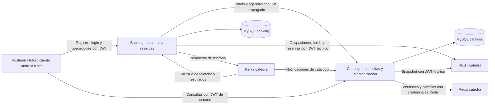

# Arquitectura de los backends

## Alcance

La entrega backend incluye dos aplicaciones Java 25/Spring Boot y dos bases
MySQL independientes. Android/KMP es un cliente previsto para la etapa de
frontend; no forma parte de la implementación validada en este documento.
Postman permite ejecutar manualmente los contratos actuales.

## Responsabilidades y despliegue

Catálogo es el único propietario de la réplica local de categorías,
profesionales y agendas. Booking no copia ese catálogo: obtiene agendas por
HTTP cuando necesita validar disponibilidad. Cada servicio ejecuta sus propias
migraciones Flyway y utiliza exclusivamente sus tablas.

`compose.integration.yaml` define las redes internas `catalog-data` y
`booking-data`, con bases sin puertos publicados. Cada aplicación se conecta a
su red de datos y a la red común `backend`. Booking accede a catálogo por
`http://catalog:8080`. Los volúmenes de MySQL son independientes.

Desde la computadora, los puertos predeterminados son `127.0.0.1:18080`
(catálogo) y `127.0.0.1:18081` (booking). Los healthchecks ordenan el arranque;
no demuestran que una reserva real pueda completarse en cátedra.

## Identidad y seguridad

Booking registra usuarios activos, almacena hashes Argon2id y emite JWT HS256.
Ambos servicios validan firma, emisor, audiencia y vigencia. Booking propaga el
JWT del usuario a catálogo: no transforma una consulta de usuario en una
operación con privilegios técnicos. Las consultas de catálogo requieren
`ROLE_USER`. Booking verifica la propiedad de los procesos usando la identidad
autenticada; un proceso ajeno no se expone.

El secreto de firma se comparte mediante configuración, con emisor y audiencia
compatibles. Esto simplifica la integración, pero ambos servicios que conocen
el secreto podrían firmar tokens. Catálogo tampoco consulta la activación del
usuario en booking para cada petición: la revocación no es inmediata antes del
vencimiento del JWT. Es una limitación del diseño actual.

La cuenta técnica de cátedra es distinta de los usuarios locales. Su JWT y las
credenciales Redis permanecen en el entorno del backend. `.env.integration`
no se versiona. El flujo público de registro/login utiliza CSRF; las operaciones
con Bearer JWT utilizan la configuración de resource server. CORS en booking se
configura para los orígenes permitidos; no sustituye autenticación.

El despliegue documentado publica HTTP únicamente en loopback. No incorpora
terminación TLS: un despliegue accesible por red requiere configurar HTTPS y
el acceso del cliente antes de exponer estos endpoints.

## Consistencia y recuperación

Catálogo aplica snapshots e incrementos con su versión en una transacción.
Ante discontinuidades reconstruye desde snapshot. Kafka notifica cambios y la
recuperación periódica permite detectar versiones aunque falte una notificación.
Las consultas leen la copia local, que puede quedar desactualizada durante una
caída de cátedra.

Booking conserva el progreso del proceso antes de ejecutar operaciones remotas.
Un timeout no implica que cátedra haya rechazado la operación. Los estados
inciertos requieren consulta/reconciliación; no se reenvían automáticamente
operaciones de creación que puedan duplicarse.

La inbox deduplica eventos y permite procesar solicitudes recibidas antes de
poder correlacionarlas. La outbox persiste respuestas de teléfono y reintenta
la publicación con el mismo identificador. El acuse del broker no equivale a
una reserva confirmada: el resultado llega por Kafka o se reconcilia por REST.
Los resultados terminales se protegen frente a eventos atrasados.

Si se pierde la respuesta de creación de un hold y no se conoce el identificador
remoto, la reconciliación no puede inventarlo. Esta limitación del contrato
externo queda visible como un proceso incierto.

## Ejecución y evidencia

Ver [Compose y validación](features/integracion-docker/SPEC.md),
[evidencia registrada](features/integracion-docker/VALIDATION.md),
[contratos entre servicios](contratos-entre-servicios.md) y
[modelo de datos](modelo-datos.md).

La prueba integral con simulador REST y Kafka local pasó. La prueba completa de
reserva contra cátedra sigue pendiente por indisponibilidad del servidor.
