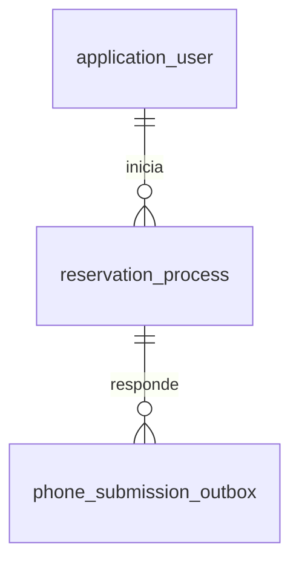
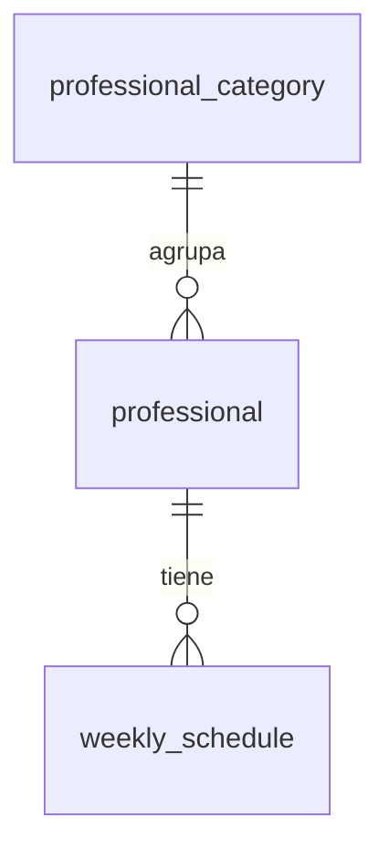

# Modelo de datos y propiedad

Las siguientes tablas describen las migraciones actuales. Cada servicio tiene
una base MySQL, credenciales y volumen propios. No hay claves foráneas entre
bases. Flyway administra el esquema de cada aplicación.

## Booking (migraciones V1 a V7)

| Tabla | Propósito y restricciones principales |
| --- | --- |
| `application_user` | UUID local; login y email únicos; hash de contraseña, perfil, activación y autoridad administrados por el backend |
| `reservation_process` | Progreso de reserva, dueño, horario, IDs remotos y resultado; FK a usuario; `(user_id, request_id)` único; `hold_id` y `remote_process_id` únicos cuando existen |
| `booking_event_inbox` | Evento recibido y payload JSON, correlación remota y estado de procesamiento; `event_id` es PK para deduplicación |
| `phone_submission_outbox` | Mensaje de teléfono pendiente/publicado, intentos, próxima ejecución y lease; FK a proceso; `(request_event_id, response_round)` único |

La inbox se correlaciona lógicamente con `remote_process_id`; no tiene FK al
proceso porque un evento puede llegar antes de que este pueda asociarse.
El `professional_id` de una reserva es una referencia externa, no una FK ni una
copia del catálogo. El UUID del usuario local identifica al propietario y se
utiliza como `externalPatientId` en la integración.

V3 agrega nombres y comienzo de confirmación. V4 incorpora inbox y solicitud de
teléfono. V5 incorpora outbox; V6 permite rondas de corrección y agrega el
resultado remoto. V7 conserva el intento y resultado de cancelación en el propio
proceso. No existe una tabla independiente de reservas: el proceso conserva la
referencia `reservation_id` y la consulta de reservas propias utiliza REST de
cátedra.

Los payloads persistidos pueden contener datos del usuario y teléfono ficticio;
no deben incluirse en logs ni exponerse como volcados de tablas. Los tokens
JWT y las contraseñas técnicas no forman parte de estas tablas.

## Catálogo (migraciones V1 y V2)

| Tabla | Propósito y restricciones principales |
| --- | --- |
| `professional_category` | Categorías e indicador de habilitación; ID de cátedra |
| `professional` | Profesionales, habilitación y FK a categoría |
| `weekly_schedule` | Agenda semanal y FK a profesional; día válido, duración positiva e inicio anterior a fin |
| `catalog_sync_state` | Una fila (`id=1`) con versión aplicada y fecha, ambas nulas antes de inicializar |
| `processed_catalog_event` | Identificador único de evento, versión y fecha de procesamiento |

Las bajas lógicas se representan con `enabled`. Datos y versión se aplican de
forma consistente para que las consultas no observen una versión que no
corresponde al contenido. Booking nunca modifica estas tablas.

## Persistencia y límites

Reiniciar contenedores conserva los volúmenes. Eliminar volúmenes borra usuarios,
procesos y progreso de sincronización; no es un procedimiento de recuperación.
La validación local usa otro proyecto Compose y bases propias. Ver
[arquitectura](arquitectura.md) y [evidencia de persistencia tras reinicio](features/integracion-docker/VALIDATION.md).
